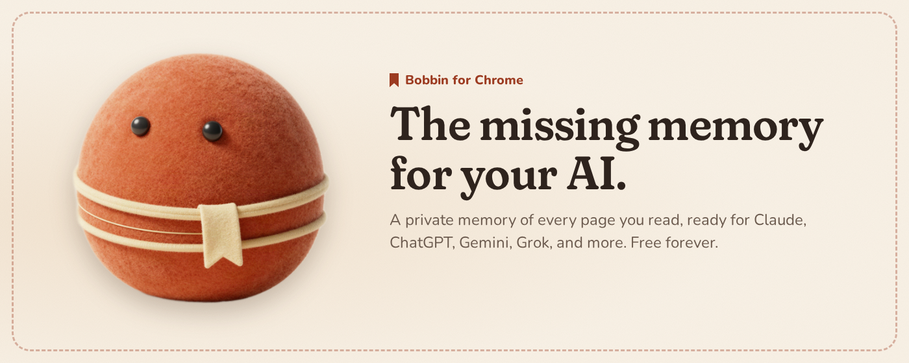
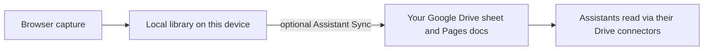
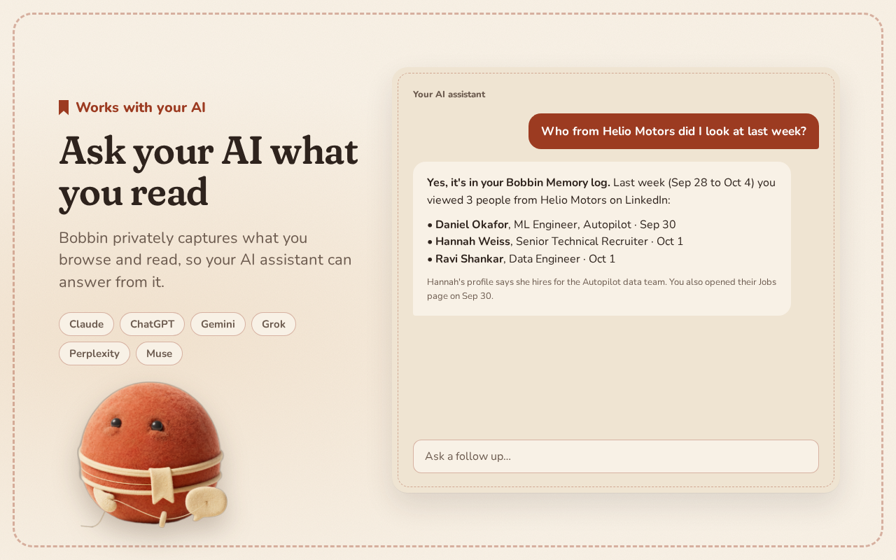
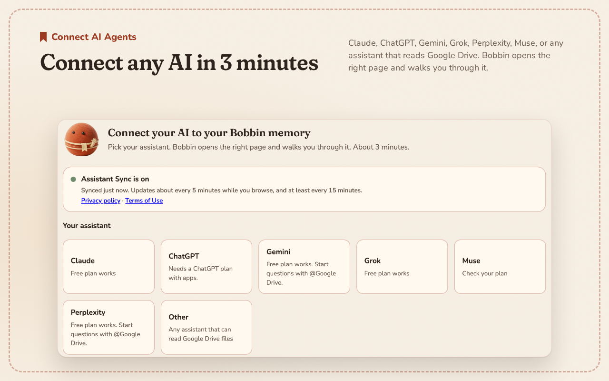
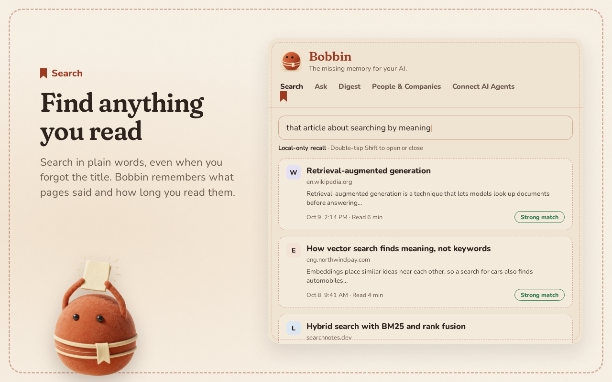
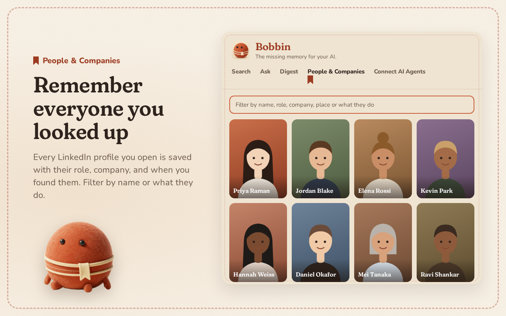
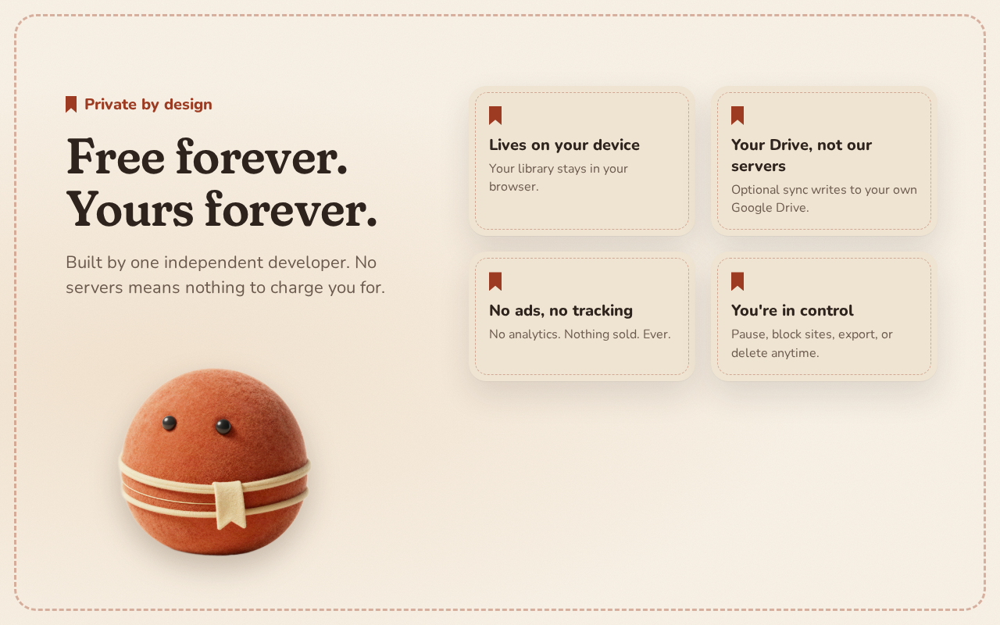

# Bobbin



**The missing memory for your AI.**

Bobbin privately captures what you browse and read, so your AI assistant knows it too.

[Chrome Web Store](https://chromewebstore.google.com/detail/happibddmmagkgneicjkndapcpmhdbfn)

## What it does

- Remembers readable pages you open, after you press I agree, and keeps that library on this device.
- Lets you search what you read, ask questions with citations, and browse people and companies you looked up.
- Optionally copies the same memory into a Google Drive folder you own, so Claude, ChatGPT, Gemini, and other assistants can read it.

## How it works



Indexing, search, and Ask run in the extension. There is no Bobbin server. Assistant Sync is off until you enable it. When it is on, Bobbin writes a spreadsheet and one Google Doc per day into a folder named Bobbin Memory, using the `drive.file` scope (files Bobbin creates, not the rest of your Drive).

## Supported assistants

| Assistant | Plan notes |
| --- | --- |
| Claude | Free plan works |
| ChatGPT | Needs a ChatGPT plan with apps |
| Gemini | Free plan works. Start questions with @Google Drive |
| Grok | Free plan works |
| Perplexity | Free plan works. Start questions with @Google Drive |
| Muse | Check your plan |
| Other | Any assistant that can read Google Drive files |

Connect walks you through linking an assistant. Ask any assistant can also put a short context packet into a chat without Drive.

## Privacy

- Capture and search stay on this device.
- Assistant Sync is optional and writes only to your own Google Drive, with `drive.file`.
- There are no Bobbin servers and no ads.

[Privacy policy](https://skumar54uncc.github.io/Bobbin/privacy) · [Terms of use](https://skumar54uncc.github.io/Bobbin/terms)

## Screenshots











## Development

Requires Node 20.

```bash
npm ci
npm run build
```

Then open `chrome://extensions`, turn on Developer mode, choose Load unpacked, and select the `dist` folder.

```bash
npm test               # unit tests and eval tests
npm run typecheck
npm run e2e            # Playwright (build first)
npm run check:budget
```

Use `npm run build:store` only when packaging the Chrome Web Store zip. That build uses the store OAuth client and omits the unpacked `key`. After a store build, run `npm run build` again if you still load `dist` unpacked.

## Project structure

| Path | |
| --- | --- |
| `src/` | Extension source: service worker, overlay, popup, settings, Connect, sync |
| `tests/` | Vitest unit tests |
| `e2e/` | Playwright end-to-end tests |
| `eval/` | Retrieval eval corpus and harness |
| `docs/` | GitHub Pages site, policy pages, release notes |
| `assets/` | Mascot and assistant-logo assets used by the build |
| `icons/` | Toolbar and store icons |
| `scripts/` | npm build and maintenance scripts |
| `config/` | OAuth client ids for unpacked vs store builds |
| `vendor/` | Bundled on-device embedding model |
| `.github/` | CI workflow |

## Release

See [docs/release.md](docs/release.md).

## Feedback

- [Feedback form](https://docs.google.com/forms/d/e/1FAIpQLSeC5bLybg056jJQzpohfgSX8r1OWlgtT7LSlSeHgvbT3CqQCQ/viewform)
- [GitHub issues](https://github.com/skumar54uncc/Bobbin/issues)

## License

[MIT](LICENSE)
